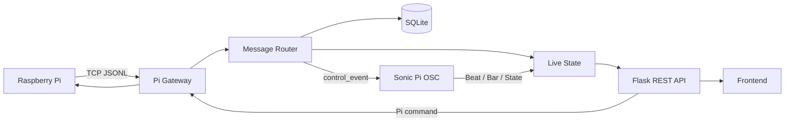

# 后端进度与结构说明  
**日期**：2026-07-23  
**后端目录**：`backend/`

本文档记录当前 PC 后端的完成进度、代码结构、通信链路、接口和待联调事项，方便组内同步与项目交接。

---

## 1. 当前进度

后端已经完成 PC 端控制中心的基本框架，当前核心链路为：

```text
Raspberry Pi 5
    -> TCP + JSON Lines
    -> PC 后端消息路由
    -> 实时状态 + SQLite
    -> Sonic Pi OSC 控制
    -> Flask REST API
    -> 前端展示
```

| 模块 | 状态 | 当前实现 |
|---|---:|---|
| Flask 服务 | 已完成 | 提供设备、传感器、手势、音乐、Pi 和 Sonic Pi 相关 REST API。 |
| Pi ↔ PC 通信 | 已完成 | PC 作为 TCP Server，Pi 作为 Client，默认监听 `9000` 端口。 |
| Pi 上行消息 | 已完成 | 接收 `fused_frame`、`control_event`、`status` 三类 JSONL 消息。 |
| Pi 下行命令 | 已完成 | 可通过同一 TCP 连接发送 LED、系统控制和时间同步命令。 |
| 实时状态管理 | 已完成 | 维护摄像头、双 Micro:bit、Pi 消息、控制事件和音乐状态。 |
| SQLite 数据库 | 已完成 | 保存 Pi 消息、传感器记录、模型预测和 Session 基础信息。 |
| Sonic Pi 控制 | 已完成 | 通过 OSC 控制播放、BPM、重音、音量和音乐能量。 |
| Sonic Pi 反馈 | 已完成 | 接收 Beat、Bar、State、Ack 和 Error，并同步到音乐状态。 |
| 模型适配层 | 接口已完成 | 支持加载 `GestureClassifier`、执行推理和校验模型输出。 |
| 后端测试 | 已编写 | 覆盖消息路由、状态映射、数据库、REST API 和 OSC 命令映射。 |
| MQTT | 已停用 | 当前架构不再使用 MQTT，原文件仅保留兼容 Stub。 |

---

## 2. 后端目录结构

```text
backend/
├── .env.example        # 环境变量示例
├── README.md           # 启动方式与接口说明
├── app.py              # Flask 应用入口和 REST API
├── database.py         # SQLite 初始化、写入和查询
├── integration.py      # 模型、状态、数据库和 Pi 命令集成
├── message_router.py   # Pi 上行消息校验与分发
├── model_service.py    # 手势模型加载与推理适配
├── mqtt_client.py      # 已停用的 MQTT 兼容 Stub
├── pi_gateway.py       # Pi ↔ PC TCP + JSON Lines 网关
├── requirements.txt    # Python 依赖
├── sonic_pi.py         # Sonic Pi OSC 发送与监听
├── state.py            # 线程安全的实时状态管理
└── test_backend.py     # 后端验收测试
```

### 关键文件职责

| 文件 | 主要职责 |
|---|---|
| `app.py` | 初始化数据库、模型、Pi Gateway 和 Sonic Pi，并注册 API。 |
| `pi_gateway.py` | 管理 TCP 连接、断线重连、JSONL 分帧和双向消息发送。 |
| `message_router.py` | 标准化 Pi 消息，写入数据库，并分发到实时状态和 Sonic Pi。 |
| `state.py` | 保存前端需要的传感器、设备、控制事件和音乐状态。 |
| `sonic_pi.py` | 将控制事件映射成 OSC 命令，并接收真实节拍反馈。 |
| `database.py` | 管理 Pi 消息、传感器记录和预测历史。 |
| `model_service.py` | 加载模型并校验模型推理结果。 |
| `test_backend.py` | 使用示例数据验证后端主要链路。 |

---

## 3. 后端数据流程



主要处理步骤：

1. `pi_gateway.py` 接收 TCP 数据并按换行符解析 JSON；
2. `message_router.py` 校验消息类型并统一消息结构；
3. 所有 Pi 消息写入 SQLite；
4. `state.py` 更新前端需要的实时状态；
5. `control_event` 被转换为 Sonic Pi 音乐控制命令；
6. Sonic Pi 的真实节拍和状态反馈再次写入实时状态；
7. 前端通过 Flask API 获取最新数据。

---

## 4. Pi ↔ PC 通信

### 4.1 连接方式

```text
PC 角色：TCP Server
Pi 角色：TCP Client
协议：TCP + JSON Lines
默认地址：0.0.0.0:9000
```

后端支持单 Pi 连接和断线重连，并记录连接地址、收发消息数、最近接收时间和最近错误。

### 4.2 Pi 上行消息

当前实际支持三种消息：

| 消息类型 | 后端处理 |
|---|---|
| `fused_frame` | 更新摄像头、手部检测以及左右 Micro:bit 实时数据。 |
| `control_event` | 更新当前动作和音乐参数，并触发 Sonic Pi 命令。 |
| `status` | 更新摄像头、Micro:bit、网络和 LED 等设备状态。 |

推荐消息格式：

```json
{
  "schema_version": "draft",
  "message_type": "status",
  "session_id": "session-001",
  "packet_sequence": 1,
  "payload": {}
}
```

联调期间也兼容 `type` 代替 `message_type`，以及业务字段直接放在消息顶层。

### 4.3 Pi 下行消息

后端可以发送：

```text
led_command
led_state
led_config
system_command
time_sync
```

---

## 5. Flask REST API

默认地址：`http://localhost:5000`

| 方法 | 路径 | 作用 |
|---|---|---|
| `GET` | `/api/status` | 后端和各设备总体状态。 |
| `GET` | `/api/pi/status` | Pi Gateway、消息计数和最近控制事件。 |
| `GET` | `/api/pi/messages` | 查询保存的 Pi 消息。 |
| `POST` | `/api/pi/send` | 向 Pi 发送 LED 或系统命令。 |
| `GET` | `/api/gesture/current` | 当前手势和置信度。 |
| `GET` | `/api/gesture/history` | 历史预测记录。 |
| `GET` | `/api/sensors/live` | 摄像头和双 Micro:bit 实时数据。 |
| `GET` | `/api/music/state` | 当前 BPM、音量、能量、Bar、Beat 和播放状态。 |
| `GET` | `/api/sonic-pi/status` | Sonic Pi OSC 连接与收发状态。 |
| `POST` | `/api/sonic-pi/transport` | 控制播放、暂停、停止和重置。 |
| `POST` | `/api/sonic-pi/state` | 手动更新 BPM、音量和能量等音乐参数。 |

---

## 6. 实时状态管理

`state.py` 使用线程锁，保证 TCP 接收、OSC 接收和 Flask 请求并发运行时的数据安全。

| 状态 | 主要内容 |
|---|---|
| 传感器状态 | 摄像头数据、手部数量、左右 Micro:bit 数据和时间戳。 |
| Pi 状态 | 最近消息、各消息类型计数、设备状态和最近控制事件。 |
| 音乐状态 | 播放状态、BPM、音量、能量、段落、Bar、Beat 和进度。 |

当前字段映射：

- `fused_frame.payload.microbits` 按 `hand=left/right` 更新左右手数据；
- `status.payload.microbits.left/right` 更新 Micro:bit 在线状态；
- `control_event.payload.music_control` 更新 BPM、音量、能量和风格；
- Sonic Pi 的 Beat/Bar 反馈更新前端的演奏进度。

---

## 7. Sonic Pi 集成

默认 OSC 配置：

```text
Backend -> Sonic Pi: 127.0.0.1:4560
Sonic Pi -> Backend: 127.0.0.1:4561
```

后端发送：

```text
/conductor/transport
/conductor/bpm
/conductor/accent
/conductor/state
```

后端监听：

```text
/music/beat
/music/bar
/music/state
/music/ack
/music/error
/music/pong
```

当前动作映射：

- `downbeat`、手腕击打、双手击打、`resume`：开始或恢复播放；
- `cutoff`、`stop`、`gesture_end`：停止或暂停；
- `tempo_up`、`tempo_down`：调整 BPM；
- `crescendo`、`decrescendo`：调整音量和能量；
- 击打类事件：发送重音命令。

只有收到 Sonic Pi 的 `/music/*` 反馈后，后端才将其判断为已连接。

---

## 8. SQLite 数据库

默认路径：`data/aiot.db`

| 表 | 作用 |
|---|---|
| `sensor_records` | 保存 Micro:bit 和摄像头传感器记录。 |
| `predictions` | 保存手势、置信度、类别概率和推理延迟。 |
| `sessions` | 保存演奏 Session 基础信息。 |
| `pi_messages` | 保存 Pi 消息类型、序号、来源地址、Payload 和原始消息。 |

---

## 9. 模型接入状态

后端已经预留同进程模型接口：

```python
from model.inference import GestureClassifier
```

模型需要实现：

```python
GestureClassifier(model_path=...).predict(window_data)
```

返回结果至少需要包含：

```text
gesture, confidence, gesture_id, timestamp, features_used, all_probs
```

真实模型尚未准备好时，Flask 后端仍可启动。当前 Pi 端的 `control_event` 也可以直接驱动 Sonic Pi 和前端，因此硬件演示链路不依赖模型先完成。

---

## 10. 运行与测试

安装依赖：

```bash
cd backend
python -m pip install -r requirements.txt
```

启动后端：

```bash
python app.py
```

运行验收测试：

```bash
python test_backend.py
```

测试脚本覆盖三类 Pi 消息、状态映射、SQLite、全部查询 API、Sonic Pi 控制接口，以及 Pi 未连接时的错误处理。

---

## 11. 待完成事项

| 优先级 | 事项 | 说明 |
|---:|---|---|
| 高 | Pi 真机联调 | 验证三类消息、断线重连、频率和字段完整性。 |
| 高 | Sonic Pi 联调 | 验证正式编曲接收命令并返回 Beat、Bar 和 State。 |
| 高 | 前后端联合演示 | 检查实时传感器、设备和音乐状态的完整展示。 |
| 中 | 模型最终接入 | 接入正式分类器和模型文件，验证真实推理。 |
| 中 | Session 管理 | 在演奏开始和结束时维护数据库 Session。 |
| 低 | 清理旧说明 | 删除部分文件中遗留的 `window_features` 描述，与三类消息实现保持一致。 |
| 低 | WebSocket | 当前前端以 REST 轮询为主，后续可增加实时推送。 |

---

## 12. 当前总结

后端的软件主链路已经完成：

```text
Pi 数据接收
-> 消息路由与数据库记录
-> 实时状态维护
-> Sonic Pi 音乐控制与反馈
-> Flask API 提供给前端
```

下一阶段的重点是 Pi、Sonic Pi、模型和前端之间的真实设备联合联调，而不是继续搭建基础框架。
