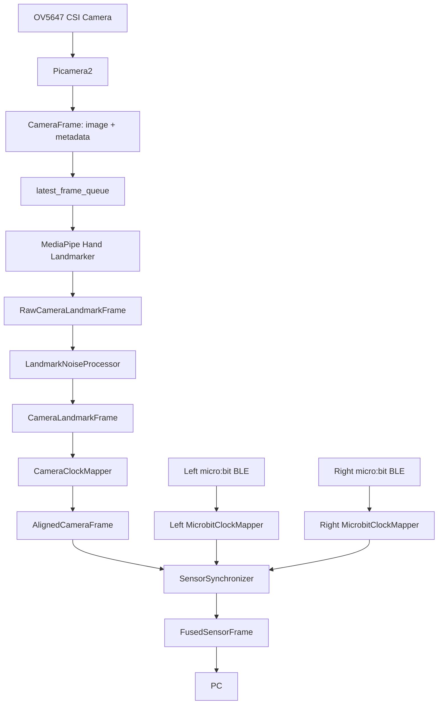

摄像头采集数据各层之间的关系？


置信度如何实现？

```
OV5647 摄像头
  ↓
Picamera2 获取图像和帧元数据
  ↓
MediaPipe Hand Landmarker
  ↓
第三层：左右手、置信度、21 个关键点
  ↓
树莓派基础质量处理
  ├── 关键点有效性检查
  ├── 左右手标签稳定
  ├── 异常跳点标记
  ├── 轻量关键点滤波
  └── 短时缺失标记或补点
  ↓
树莓派统一时间轴
  ├── 摄像头时间映射到 Pi 单调时间
  ├── 左 micro:bit 时间映射到 Pi 单调时间
  └── 右 micro:bit 时间映射到 Pi 单调时间
  ↓
按时间对齐并整理为 FusedSensorFrame
  ↓
发送给 PC
  ↓
PC 计算第四层特征、训练模型并实时判断动作
```


# 摄像头 --> 树莓派

| 内容       | 说明                                                   |
| ---------- | ------------------------------------------------------ |
| 连接方式   | 树莓派 CSI 摄像头                                      |
| 采集方式   | Picamera2                                              |
| 树莓派程序 | Python + MediaPipe Hand Landmarker + OpenCV            |
| 采集内容   | 视频帧、左右手、21 个关键点、置信度、相对三维坐标      |
| 输出数据   | 手部即时特征和简化关键点数据，不持续向 PC 发送原始视频 |

## 1. 文档范围

本文档设计智能指挥系统中“摄像头至树莓派”链路，主要定义：

1. 摄像头需要采集的原始数据和元数据；
2. 摄像头与树莓派之间的硬件通信方式；
3. Picamera2 与树莓派 Python 程序的对接方式；
4. 树莓派内部的图像队列、手部检测和特征输出结构；
5. 摄像头数据与双 micro:bit 数据进行时间同步时需要保留的字段；
6. 丢帧、遮挡、识别失败和摄像头异常时的处理方式。

本文档不定义树莓派与 PC 的最终网络协议、PC 端动态动作 AI 模型、micro:bit BLE 数据包、音乐与 LED 接口，以及最终多模态时间对齐算法。

## 2.总体通信链路

### 2.1 硬件链路

```
摄像头图像传感器
  ↓ MIPI CSI-2
树莓派 CSI 接口
  ↓
Unicam / V4L2 驱动
  ↓
libcamera
  ↓
Picamera2 Python API
  ↓
NumPy 图像帧 + 摄像头元数据
```

CSI 摄像头通过排线直接连接树莓派，底层图像传输由 MIPI CSI-2、Linux 摄像头驱动、libcamera 和 Picamera2 共同完成。

------

### 2.2 软件处理链路



------

## 3.摄像头需要采集的数据

摄像头相关数据分成四层：

1. 原始图像帧；
2. 摄像头帧元数据；
3. 手部关键点检测结果；
4. 树莓派计算的即时视觉特征。

------

## 4.第一层：原始图像帧

### 4.1 采集参数(待确认)

| 参数       |      推荐值 | 说明                              |
| ---------- | ----------: | --------------------------------- |
| 分辨率     | `640 × 480` | 足够进行双手检测，树莓派负载较低  |
| 帧率       |    `30 FPS` | 约每 33.3 ms 一帧                 |
| 像素格式   |    `RGB888` | 便于转换为 MediaPipe 的 SRGB 图像 |
| 最大手数   |           2 | 左、右手各一只                    |
| 图像方向   |        固定 | 部署后不要运行中随意旋转或镜像    |
| 原始帧队列 |     1～2 帧 | 保持低延迟，避免旧帧积压          |

### 4.2 数据结构

| 字段                   | 类型            | 说明                                |
| ---------------------- | --------------- | ----------------------------------- |
| `frame_sequence`       | `uint64`        | 树莓派为每个成功获取的帧递增编号    |
| `sensor_timestamp_ns`  | `uint64`        | 摄像头栈为该帧提供的时间戳          |
| `pi_frame_received_ns` | `uint64`        | 树莓派程序取得该帧时记录的单调时间  |
| `width`                | `uint16`        | 图像宽度                            |
| `height`               | `uint16`        | 图像高度                            |
| `pixel_format`         | `string`        | 推荐为 `RGB888`                     |
| `image`                | `numpy.ndarray` | 当前 RGB 图像，仅在树莓派内存中使用 |

```python
@dataclass(slots=True)
class CameraFrame:
    frame_sequence: int
    sensor_timestamp_ns: int
    pi_frame_received_ns: int

    width: int
    height: int
    pixel_format: str

    image: np.ndarray
```

### 4.3 处理方式

默认运行模式：

```text
原始帧
  ↓
仅进入树莓派本地视觉处理
  ↓
处理完成后释放
```

原始帧一般不进行保存，仅在以下情况下保存：

- 模型训练数据采集；
- 识别错误复现；
- 摄像头安装角度调试；
- 答辩演示画面；
- 短时间性能测试。

------

## 5. 第二层：摄像头元数据 `metadata`

`metadata`:由 `libcamera`/Picamera2 随这一帧返回的字典数据。包含摄像头时间戳、曝光时间、模拟增益、一帧持续时间等。

### 5.1 保留的元数据

| 字段                   | 来源               | 用途                                          |
| ---------------------- | ------------------ | --------------------------------------------- |
| `SensorTimestamp`      | Picamera2 metadata | 标记图像真实采集时间，用于与双 micro:bit 对齐 |
| `frame_sequence`       | 树莓派自行生成     | 标识帧顺序、检测跳帧                          |
| `pi_frame_received_ns` | 树莓派自行记录     | 计算图像从采集到程序接收的延迟                |

### 5.2 备选保留的元数据

| 字段            | 用途                                   |
| --------------- | -------------------------------------- |
| `ExposureTime`  | 曝光过长时，快速挥手容易产生运动模糊   |
| `AnalogueGain`  | 增益过高通常说明光线不足、图像噪声较大 |
| `FrameDuration` | 检查实际帧间隔和实际 FPS               |

### 5.3 图像和元数据必须属于同一帧

```
第一层：图像 image
第二层：metadata
        ↓
组合成同一帧对象 CameraFrame
        ↓
image 单独送入 MediaPipe
        ↓
得到第三层手部关键点
        ↓
关键点继续携带原帧的序号和时间戳
```

MediaPipe 实际分析的是：

```python
camera_frame["image"]
```

不是：

```python
camera_frame["image"] + camera_frame["metadata"]
```

图像和元数据要从同一个 Picamera2 请求中获取，以确保是属于同一帧：

```python
request = picam2.capture_request()

try:
    image = request.make_array("main")
    metadata = request.get_metadata()
finally:
    request.release()
```

------

## 6. 第三层：手部关键点数据

MediaPipe Hand Landmarker 对每只检测到的手输出：

- 左右手分类；
- 左右手分类置信度；
- 21 个图像归一化关键点；
- 21 个相对三维世界关键点。

### 6.1 单手关键点结构

```python
@dataclass(slots=True)
class Landmark3D:
    x: float
    y: float
    z: float


@dataclass(slots=True)
class HandLandmarkObservation:
    hand_label: str
    handedness_score: float

    image_landmarks: list[Landmark3D]
    world_landmarks: list[Landmark3D]

    detection_valid: bool
```

| 字段               | 类型                 | 说明                                                         |
| ------------------ | -------------------- | ------------------------------------------------------------ |
| `hand_label`       | `left/right/unknown` | 用户物理左手或右手                                           |
| `handedness_score` | `float32`            | 左右手分类置信度                                             |
| `image_landmarks`  | `21 × (x,y,z)`       | 图像归一化关键点(在摄像头画面中的位置)                       |
| `world_landmarks`  | `21 × (x,y,z)`       | MediaPipe 输出的手部相对世界坐标(手部自身局部三维空间中的位置) |
| `detection_valid`  | `bool`               | 当前手是否可信,包括关键点有效和左右手标签可靠                |
| `tracking_id`      | `uint8`              | 树莓派内部临时跟踪编号，可选(暂不采用)                       |

### 6.2 21个关键点的含义

|   编号 | 位置   |
| -----: | ------ |
|      0 | 手腕   |
|   1～4 | 拇指   |
|   5～8 | 食指   |
|  9～12 | 中指   |
| 13～16 | 无名指 |
| 17～20 | 小指   |

常用指尖编号：

| 手指     | 编号 |
| -------- | ---: |
| 拇指尖   |    4 |
| 食指尖   |    8 |
| 中指尖   |   12 |
| 无名指尖 |   16 |
| 小指尖   |   20 |

### 6.3 image_landmarks

```
x：0.0～1.0，从图像左侧到右侧
y：0.0～1.0，从图像顶部到底部
z：相对于手腕的深度描述
```

转换成像素坐标：

```text
pixel_x = x × image_width
pixel_y = y × image_height
```

适合计算：

- 手腕在画面中的位置；
- 掌心在画面中的位置；
- 手向上、向下、向左、向右移动；
- 手部运动速度；
- 手部运动轨迹；
- 左右手的画面距离；
- 双手张开、合拢；
- 手是否超出指挥区域。

### 6.4 world_landmarks

其坐标单位不是图像归一化值，而是官方所称的**米制三维坐标**，坐标原点位于**该只手的几何中心**。每只手都有自己的局部坐标系。21 个关键点的编号与 `image_landmarks` 完全相同。

适合计算：

- 手指弯曲角度
- 手掌朝向
- 手部开合度
- 手部自身姿态

不适合计算：

- 手到摄像头的绝对距离
- 双手之间的真实距离
- 整只手的平移
- 高精度真实尺寸

### 6.5 两者的用法

`image_landmarks` 用于指挥动作

建议用于：

```
手腕位置
掌心位置
上挥、下挥
左右移动
动作速度
动作方向
双手距离
双手展开和合拢
指挥区域位置
与 micro:bit 对齐
```

`world_landmarks` 用于手部姿态

建议用于：

```
手掌朝向
手掌翻转
手指开合
握拳或张开
拇指和食指距离
手指弯曲角度
局部手型识别
```

### 6.6 第三层数据结构

```python
@dataclass(slots=True)
class Landmark3D:
    x: float
    y: float
    z: float


@dataclass(slots=True)
class HandLandmarkObservation:
    hand_label: str
    handedness_score: float

    image_landmarks: list[Landmark3D]
    world_landmarks: list[Landmark3D]

    detection_valid: bool
```

关键点结果必须和来源帧绑定：

```python
@dataclass(slots=True)
class LandmarkFrame:
    frame_sequence: int
    sensor_timestamp_ns: int
    pi_frame_received_ns: int
    hands: list[HandLandmarkObservation]
    hands_detected: int
```

`hands_detected`用于判断当前帧检测到了几只手，用于区分：

```text
摄像头正常，但画面中没有手
```

与：

```text
摄像头没有产生新帧
```

------

## 后续数据滤波 + 时间同步整理注意

| 内容     | 说明                             |
| -------- | -------------------------------- |
| 通信方案 | JSON Lines                       |
| 数据类型 | JSON                             |
| 数据格式 | fused_frame/control_event/status |
| 通信端口 | 9000                             |

### 最终 Pi --> PC 的数据接口

**数据类型优化为三个**

| 数据类型        | 内容                           | 树莓派负责生成什么       | PC 收到后做什么          | 是否直接控制音乐 |
| --------------- | ------------------------------ | ------------------------ | ------------------------ | ---------------- |
| `fused_frame`   | 一个统一时间点上的完整感知状态 | 单时刻同步数据和即时特征 | 实时显示、调试、模型输入 | 否               |
| `control_event` | 检测按钮事件和安全事件         | 按钮事件、安全事件       | 执行、实现按钮事件效果   | 可以             |
| `status`        | 系统健康状态，不表示用户动作   | 设备和链路健康状态       | 状态显示、降级和重连     | 否               |

### fused_frame 中用于模型训练和动作判断的关键数据

在头部字段**统一时间戳和序号**！

#### `left_microbit` 和 `right_microbit`

| 字段        | 说明                           |
| ----------- | ------------------------------ |
| `ax_mg`     | X 轴加速度，单位 mg            |
| `ay_mg`     | Y 轴加速度，单位 mg            |
| `az_mg`     | Z 轴加速度，单位 mg            |
| `pitch_deg` | Pitch(前后倾斜角)，单位 degree |
| `roll_deg`  | Roll(左右倾斜角)，单位 degree  |

#### `camera`

| 字段                     | 说明                                                         |
| ------------------------ | ------------------------------------------------------------ |
| `hands_detected`         | 检测到手数量                                                 |
| `hands/hands_label`      | 区分左右手                                                   |
| `hands/handedness_score` | 左右手分类置信度                                             |
| `hands/image_landmarks`  | 图像归一化关键点(在摄像头画面中的位置)                       |
| `hands/world_landmarks`  | MediaPipe 输出的手部相对世界坐标(手部自身局部三维空间中的位置) |
| `hands/detection_valid`  | 当前手是否可信,包括关键点有效和左右手标签可靠                |
