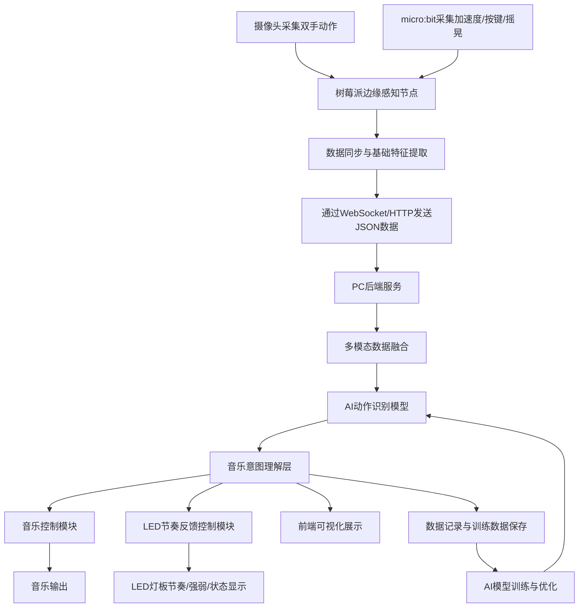
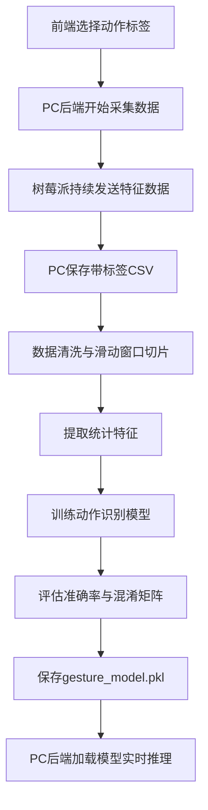

# AIoT 智能指挥演奏系统设计方案

## 1. 项目名称

**基于树莓派、micro:bit 与 PC 的 AIoT 智能指挥演奏系统**

---

## 2. 项目定位

本项目面向 AIoT 课程设计，构建一个能够通过用户双手动作和 micro:bit 传感信息实时控制音乐表现的智能指挥系统。

系统采用 **“树莓派边缘感知节点 + PC 本地智能控制中心 + LED 节奏反馈节点”** 的分布式 AIoT 架构：

- 树莓派负责摄像头采集、micro:bit 信息接收、时间戳同步和基础特征提取；
- PC 负责后端服务、前端展示、AI 模型训练与部署、音乐控制和数据存储；
- LED 灯板用于显示音乐节奏、强弱变化和用户动作反馈，增强系统交互性和可视化效果。

本阶段 **暂不实现歌曲/乐谱指挥模式**，项目重点集中在 **自由指挥模式**：用户通过动作实时控制预设风格音乐的速度、力度、能量、密度和节奏反馈。

---

## 3. 项目目标

本项目通过摄像头捕捉用户双手动作，并结合 micro:bit 采集的加速度、按键、摇晃等传感信息，利用本地 AI 模型识别用户动作并理解其音乐指挥意图，进而实时控制音乐播放和 LED 节奏灯效。

核心目标包括：

1. 实现摄像头对用户双手动作的实时采集；
2. 实现 micro:bit 对主手加速度、按键和摇晃事件的采集；
3. 实现树莓派与 PC 之间的实时数据通信；
4. 在 PC 端完成动作识别模型训练与部署；
5. 将识别结果映射为音乐控制参数；
6. 通过前端页面展示系统状态、动作识别结果和音乐参数；
7. 通过 LED 灯板显示节奏、强拍、能量变化和动作反馈；
8. 体现 AIoT 中“传感器采集、边缘节点、网络通信、本地 AI、实时反馈”的完整链路。

---

## 4. 整体架构

### 4.1 系统节点划分

系统包含四类主要节点：

| 节点 | 定位 | 主要作用 |
|---|---|---|
| 摄像头 | 视觉感知设备 | 捕捉用户双手空间动作 |
| micro:bit | IoT 传感节点 | 采集主手加速度、按键、摇晃等数据 |
| 树莓派 | 边缘感知节点 | 接入摄像头和 micro:bit，完成数据同步、预处理和转发 |
| PC | 本地智能控制中心 | 完成后端服务、AI 推理、音乐控制、前端展示和数据存储 |
| LED 灯板 | 交互反馈节点 | 显示节奏、强拍、音乐能量和系统状态 |

---

### 4.2 总体架构流程



---

### 4.3 核心数据流

```text
摄像头图像 + micro:bit 传感数据
        ↓
树莓派采集、同步、预处理
        ↓
特征数据通过网络发送到 PC
        ↓
PC 后端进行数据融合
        ↓
AI 模型识别动作类别
        ↓
音乐意图理解与参数映射
        ↓
音乐播放控制 + LED 灯板节奏反馈 + 前端展示
        ↓
数据记录与模型训练
```

---

## 5. 节点间通信方式

### 5.1 摄像头与树莓派通信

| 内容 | 说明 |
|---|---|
| 连接方式 | USB 摄像头或树莓派 CSI 摄像头 |
| 推荐方案 | 初期优先使用 USB 摄像头 |
| 树莓派程序 | Python + OpenCV |
| 采集内容 | 视频帧、手部位置、运动轨迹、速度等 |
| 输出数据 | 手部特征或简化图像信息 |

建议初期不要直接把完整视频流发送到 PC，而是在树莓派端提取基础特征后再发送，以降低网络压力和延迟。

---

### 5.2 micro:bit 与树莓派通信

| 内容 | 说明 |
|---|---|
| 连接方式 | USB Serial |
| 推荐原因 | 稳定、低延迟、调试简单 |
| micro:bit 程序 | MakeCode 或 MicroPython |
| 树莓派程序 | Python + pyserial |
| 采集内容 | acc_x、acc_y、acc_z、acc_norm、A/B 按键、摇晃事件 |
| 输出格式 | 串口文本或 CSV 格式数据 |

推荐 micro:bit 每 50ms 到 100ms 输出一次数据，例如：

```text
acc_x,acc_y,acc_z,button_a,button_b,shake
```

示例：

```text
120,-80,980,0,1,0
```

---

### 5.3 树莓派与 PC 通信

| 方案 | 特点 | 推荐程度 |
|---|---|---|
| WebSocket | 实时双向通信，适合连续动作数据 | 推荐 |
| HTTP POST | 实现简单，适合初期调试 | 可用 |
| MQTT | IoT 特征明显，但需要 Broker | 后期可选 |

本项目推荐采用：

```text
树莓派 WebSocket Client → PC WebSocket Server
```

树莓派发送给 PC 的数据建议统一为 JSON：

```json
{
  "timestamp": 1720000000.123,
  "camera": {
    "right_hand_x": 0.52,
    "right_hand_y": 0.38,
    "right_hand_speed": 0.21,
    "left_hand_x": 0.31,
    "left_hand_y": 0.44,
    "hands_distance": 0.26
  },
  "microbit": {
    "acc_x": 120,
    "acc_y": -80,
    "acc_z": 980,
    "acc_norm": 991.3,
    "button_a": 0,
    "button_b": 1,
    "shake": 0
  }
}
```

---

### 5.4 PC 与前端通信

| 内容 | 说明 |
|---|---|
| 通信方式 | WebSocket + REST API |
| 后端框架 | FastAPI 或 Flask |
| 前端技术 | HTML/CSS/JavaScript，后期可扩展 Vue/React |
| 实时展示 | 当前动作、音乐参数、micro:bit 数据、LED 状态 |
| 控制功能 | 开始/暂停、风格切换、训练数据采集、模型切换 |

建议 PC 后端提供以下接口：

| 接口 | 作用 |
|---|---|
| `GET /` | 返回前端页面 |
| `WebSocket /ws/pi` | 接收树莓派实时数据 |
| `WebSocket /ws/frontend` | 向前端推送实时识别结果 |
| `POST /api/start_record` | 开始采集某类动作训练数据 |
| `POST /api/stop_record` | 停止采集 |
| `POST /api/music/start` | 开始音乐 |
| `POST /api/music/stop` | 停止音乐 |
| `POST /api/style/switch` | 切换音乐风格 |
| `GET /api/status` | 获取系统状态 |

---

### 5.5 PC 与 LED 灯板通信

LED 灯板可采用两种连接方式。

#### 方案 A：LED 灯板连接树莓派

```text
PC 后端生成灯效指令
        ↓
网络发送到树莓派
        ↓
树莓派控制 LED 灯板
```

优点：

- LED 属于物理反馈设备，连接树莓派更符合 AIoT 硬件节点设计；
- 树莓派 GPIO 适合控制 WS2812B、NeoPixel 等 LED 灯带/灯板；
- 便于在展示时把摄像头、micro:bit、LED 作为同一套边缘硬件系统。

缺点：

- 需要在树莓派端增加 LED 控制程序；
- PC 到树莓派再到 LED 会有一层通信延迟。

#### 方案 B：LED 灯板连接 PC 或 Arduino

```text
PC 后端直接通过 USB Serial 控制 LED 控制器
```

优点：

- 音乐控制和灯效控制都在 PC 端，逻辑集中；
- 调试方便。

缺点：

- AIoT 硬件节点感较弱；
- 需要额外 Arduino/ESP32 或可串口控制的灯板。

#### 推荐方案

本项目推荐：

```text
LED 灯板连接树莓派，由 PC 后端发送灯效指令，树莓派执行灯效显示。
```

这样树莓派同时承担“感知输入”和“物理反馈输出”，更能体现 AIoT 边缘节点价值。

PC 到树莓派的 LED 指令可采用 JSON：

```json
{
  "type": "led_control",
  "mode": "beat",
  "bpm": 120,
  "energy": 0.78,
  "color": "blue",
  "flash": true
}
```

---

## 6. 各节点负责的功能与建议技术

### 6.1 树莓派边缘感知节点

#### 负责功能

1. 摄像头接入与图像采集；
2. micro:bit USB 串口数据读取；
3. 摄像头与 micro:bit 数据时间戳同步；
4. 基础特征提取；
5. 将特征数据打包为 JSON；
6. 通过 WebSocket/HTTP 发送到 PC；
7. 接收 PC 发送的 LED 控制指令；
8. 控制 LED 灯板显示节奏和反馈效果；
9. 保留简单规则识别作为本地兜底功能。

#### 建议技术

| 功能 | 推荐技术 |
|---|---|
| 摄像头读取 | Python + OpenCV |
| CSI 摄像头支持 | Picamera2 |
| micro:bit 串口读取 | pyserial |
| 数据打包 | JSON |
| 网络通信 | WebSocket Client 或 HTTP Client |
| LED 灯板控制 | rpi_ws281x / adafruit-circuitpython-neopixel |
| 本地调试 | SSH、VNC、VS Code Remote SSH |

#### 树莓派端建议目录

```text
pi_node/
├── main.py
├── camera_reader.py
├── microbit_reader.py
├── feature_extractor.py
├── websocket_client.py
├── led_controller.py
└── config.py
```

---

### 6.2 PC 后端服务节点

#### 负责功能

1. 接收树莓派传来的实时特征数据；
2. 对摄像头特征和 micro:bit 特征进行融合；
3. 调用 AI 模型进行动作识别；
4. 将动作类别转化为音乐意图；
5. 将音乐意图映射为音乐参数；
6. 控制音乐播放、节奏、音量、能量和风格；
7. 生成 LED 灯效指令并发送给树莓派；
8. 向前端推送实时状态；
9. 保存训练数据和运行日志；
10. 提供模型训练、模型切换和数据采集接口。

#### 建议技术

| 功能 | 推荐技术 |
|---|---|
| 后端框架 | FastAPI |
| 实时通信 | WebSocket |
| 数据存储 | CSV 初期，SQLite 后期 |
| AI 推理 | scikit-learn / PyTorch |
| 模型保存 | joblib / ONNX |
| 音乐控制 | pygame / pydub / mido / python-rtmidi |
| 前端接口 | REST API + WebSocket |
| 日志记录 | Python logging |

#### PC 后端建议目录

```text
pc_server/
├── app.py
├── config.py
├── pi_receiver.py
├── feature_fusion.py
├── inference.py
├── intent_mapper.py
├── music_controller.py
├── led_command.py
├── data_logger.py
├── models/
│   └── gesture_model.pkl
└── logs/
```

---

### 6.3 PC 前端展示节点

#### 负责功能

1. 展示树莓派连接状态；
2. 展示摄像头、micro:bit 和 LED 灯板状态；
3. 实时显示当前动作类别；
4. 实时显示音乐意图；
5. 显示 BPM、Volume、Energy、Density、Style 等音乐参数；
6. 显示 micro:bit 加速度曲线；
7. 显示 LED 当前灯效模式；
8. 提供开始、暂停、风格切换、数据采集按钮；
9. 提供训练数据标注界面。

#### 建议技术

| 功能 | 推荐技术 |
|---|---|
| 基础页面 | HTML + CSS + JavaScript |
| 实时数据 | WebSocket |
| 曲线显示 | Chart.js |
| UI 框架 | Bootstrap 或原生 CSS |
| 后期扩展 | Vue / React |

#### 前端页面建议模块

```text
frontend/
├── index.html
├── style.css
└── app.js
```

建议页面布局：

```text
系统状态区：树莓派 / micro:bit / 摄像头 / LED
动作识别区：当前动作 / 音乐意图 / 置信度
音乐控制区：BPM / Volume / Energy / Density / Style
传感器数据区：加速度曲线 / 手部坐标
训练采集区：采集 beat_down / crescendo / decrescendo / cutoff / idle
```

---

### 6.4 AI 模型训练模块

#### 负责功能

1. 接收并保存带标签的训练数据；
2. 对连续动作数据进行滑动窗口切片；
3. 从窗口中提取统计特征；
4. 训练动作识别模型；
5. 评估模型准确率、召回率和混淆矩阵；
6. 导出模型文件；
7. 将模型部署到 PC 后端进行实时推理；
8. 支持个性化校准和后续模型更新。

#### 推荐动作类别

| 动作类别 | 含义 | 识别依据 |
|---|---|---|
| `beat_down` | 下挥击拍 | 手部快速下移 + 加速度峰值 |
| `crescendo` | 渐强 | 左手或双手持续上升 / 幅度增大 |
| `decrescendo` | 渐弱 | 左手或双手持续下降 / 幅度减小 |
| `cutoff` | 截止 | 双手快速收回或突然静止 |
| `idle` | 无有效动作 | 动作幅度低、无明显节奏 |
| `style_switch` | 风格切换 | micro:bit A/B 按键触发，初期不必训练 |

#### 建议模型

| 模型 | 适用阶段 | 说明 |
|---|---|---|
| 规则模型 | 原型阶段 | 使用阈值快速跑通系统 |
| Random Forest | 第一版 AI 模型 | 适合小数据集、训练快、部署简单 |
| SVM | 对照模型 | 适合特征维度不高的动作分类 |
| MLP | 增强模型 | 可以体现轻量神经网络 |
| 1D-CNN / GRU | 后期扩展 | 适合连续动作序列建模 |

#### 训练数据字段建议

```csv
timestamp,right_hand_x,right_hand_y,right_hand_speed,left_hand_x,left_hand_y,hands_distance,acc_x,acc_y,acc_z,acc_norm,button_a,button_b,shake,label
```

#### AI 训练流程



---

## 7. 自由指挥模式设计

### 7.1 预设风格

本阶段只实现自由指挥模式，使用预设风格和乐器组，不实现上传歌曲/乐谱分析。

| 风格 | 乐器组 | 主要表现 |
|---|---|---|
| 古典 | 钢琴、弦乐、长笛 | 渐强、渐弱、声部厚度 |
| 电子 | 合成器、鼓机、Bass | build-up、drop、滤波变化 |
| 国风 | 古筝、笛子、二胡 | 五声音阶、旋律装饰 |
| Lo-fi | 电钢琴、软鼓、Pad | 柔和、慢速、空间感 |

初期建议优先完成 3 种：

```text
古典 / 电子 / 国风
```

---

### 7.2 动作到音乐的映射

| 用户动作 | AI 识别结果 | 音乐意图 | 系统控制 |
|---|---|---|---|
| 右手快速下挥 | `beat_down` | 强拍/重音 | 触发重音、鼓点或节拍增强 |
| 周期性上下挥动 | `tempo_control` | 控制速度 | 根据挥动周期调整 BPM |
| 左手缓慢上升 | `crescendo` | 渐强 | 增大 Volume、Energy |
| 左手缓慢下降 | `decrescendo` | 渐弱 | 降低 Volume、Energy |
| 双手张开 | `density_up` | 增加音乐密度 | 增加声部、混响或音符密度 |
| 双手合拢 | `density_down` | 收束 | 减少声部或降低密度 |
| 双手快速收回 | `cutoff` | 截止 | 暂停或停止音乐 |
| micro:bit A 键 | `style_switch` | 切换风格 | 古典/电子/国风轮换 |
| micro:bit B 键 | `instrument_switch` | 切换乐器组 | 切换主奏或伴奏 |
| micro:bit 摇晃 | `effect_trigger` | 特殊效果 | 触发鼓花、drop 或灯效爆闪 |

---

## 8. LED 灯板交互设计

LED 灯板用于把音乐节奏和系统反馈可视化，使用户能够直观看到“指挥动作影响音乐”的过程。

### 8.1 LED 显示内容

| 显示内容 | 触发来源 | 灯效表现 |
|---|---|---|
| 基础节拍 | 当前 BPM | 按节拍闪烁 |
| 强拍 | `beat_down` | 全灯短暂高亮 |
| 渐强 | `crescendo` | 亮度逐渐增强 |
| 渐弱 | `decrescendo` | 亮度逐渐降低 |
| 风格切换 | `style_switch` | 切换颜色主题 |
| 截止 | `cutoff` | 灯光快速熄灭 |
| 特殊效果 | micro:bit 摇晃 | 流水灯、爆闪或波纹 |
| 系统状态 | 连接状态 | 在线为稳定呼吸灯，异常为闪烁提示 |

---

### 8.2 音乐参数到灯效映射

| 音乐参数 | LED 表现 |
|---|---|
| BPM | 闪烁频率 |
| Volume | 整体亮度 |
| Energy | 颜色饱和度或亮度范围 |
| Density | 点亮灯珠数量 |
| Style | 颜色主题 |
| Beat | 瞬时闪烁 |
| Cutoff | 快速熄灭 |

示例：

```text
电子风格：蓝紫色 + 快速闪烁 + drop 时爆闪
古典风格：暖黄色 + 柔和渐变
国风风格：红金色 + 流水灯
Lo-fi 风格：低亮度 + 慢速呼吸灯
```

---

### 8.3 LED 技术建议

| 硬件方案 | 说明 |
|---|---|
| WS2812B / NeoPixel 灯板 | 单线控制、效果丰富，推荐 |
| 普通 RGB LED 矩阵 | 可显示简单图案，但控制复杂 |
| micro:bit LED 点阵 | 可作为最小替代方案，但显示能力有限 |
| MAX7219 点阵屏 | 适合显示节拍符号或状态图标 |

推荐优先选择：

```text
WS2812B / NeoPixel LED 灯板 + 树莓派 GPIO 控制
```

树莓派端使用：

```text
rpi_ws281x 或 adafruit-circuitpython-neopixel
```

---

## 9. AI 应用的体现

本项目的 AI 不是简单调用摄像头库，而是体现在“数据采集、模型训练、本地部署、实时推理、音乐意图映射”几个环节。

### 9.1 多模态动作识别

AI 模型输入来自两类数据：

| 数据来源 | 特征 |
|---|---|
| 摄像头 | 手部坐标、速度、方向、双手距离、轨迹变化 |
| micro:bit | 三轴加速度、加速度模长、峰值、按键、摇晃事件 |

模型输出动作类别：

```text
beat_down / crescendo / decrescendo / cutoff / idle
```

---

### 9.2 本地数据训练

系统通过前端标注界面采集不同用户的动作样本，并保存为训练数据。

训练流程：

```text
用户选择动作标签
        ↓
执行动作
        ↓
PC 后端保存摄像头和 micro:bit 特征
        ↓
训练动作识别模型
        ↓
模型文件部署到 PC 后端
```

这样可以体现：

```text
本地采集数据 + 本地训练模型 + 本地部署推理
```

---

### 9.3 本地 AI 部署

训练完成后，PC 后端加载模型文件：

```text
gesture_model.pkl
```

并在实时运行中完成动作预测：

```text
输入特征向量 → AI 模型 → 动作类别 → 音乐意图
```

模型不依赖云端 API，符合本地部署要求。

---

### 9.4 音乐意图理解

AI 动作识别之后，系统不是简单执行固定按钮逻辑，而是将动作进一步解释为音乐意图：

| 动作类别 | 音乐意图 |
|---|---|
| `beat_down` | 强调当前拍点 |
| `crescendo` | 增强音乐能量 |
| `decrescendo` | 降低音乐能量 |
| `cutoff` | 停止或收束 |
| `idle` | 保持当前状态 |

音乐意图再映射到实际控制参数：

| 参数 | 含义 |
|---|---|
| BPM | 音乐速度 |
| Volume | 音量 |
| Energy | 音乐能量 |
| Density | 音符密度 |
| Style | 音乐风格 |
| LED Mode | 灯效模式 |

---

### 9.5 个性化校准

不同用户的指挥动作幅度和速度不同，系统可以记录用户动作数据，自动调整阈值或重新训练模型。

示例：

```text
用户执行 5 次下挥、5 次渐强、5 次截止
        ↓
系统统计该用户动作幅度、速度、加速度峰值
        ↓
调整动作识别阈值或更新模型
        ↓
提高该用户的识别准确率
```

---

## 10. 最小可行版本

初步实现建议控制范围，不做过复杂功能。

### 10.1 树莓派端 MVP

1. 摄像头采集画面；
2. 提取手部位置或基础运动特征；
3. 读取 micro:bit 串口数据；
4. 打包 JSON 并发送给 PC；
5. 接收 PC 的 LED 指令；
6. 控制 LED 灯板闪烁。

### 10.2 PC 后端 MVP

1. 接收树莓派发送的数据；
2. 使用规则模型识别 `beat_down`、`style_switch`、`idle`；
3. 控制音乐播放或音效触发；
4. 向前端推送实时数据；
5. 保存 CSV 数据；
6. 发送 LED 灯效指令给树莓派。

### 10.3 PC 前端 MVP

1. 显示树莓派连接状态；
2. 显示 micro:bit 加速度数据；
3. 显示当前动作类别；
4. 显示音乐参数；
5. 提供开始/暂停、风格切换按钮；
6. 提供数据采集标签按钮。

### 10.4 AI MVP

1. 采集 5 类动作数据；
2. 训练 Random Forest 动作分类模型；
3. 输出准确率和混淆矩阵；
4. 将模型部署到 PC 后端替换规则判断。

### 10.5 LED MVP

1. 根据 BPM 固定节奏闪烁；
2. `beat_down` 时全灯高亮；
3. `crescendo` 时亮度增强；
4. `cutoff` 时灯光熄灭；
5. 不同风格对应不同颜色主题。

---

## 11. 项目开发阶段安排

### 阶段一：通信链路跑通

```text
micro:bit → 树莓派 → PC 后端 → 前端显示
```

完成标志：

- 前端能显示 micro:bit 的加速度；
- PC 后端能接收树莓派 JSON 数据。

---

### 阶段二：摄像头与 micro:bit 多模态采集

```text
摄像头 + micro:bit → 树莓派 → PC
```

完成标志：

- 树莓派能同时读取摄像头和 micro:bit；
- PC 能收到带时间戳的融合数据。

---

### 阶段三：规则版自由指挥

```text
动作数据 → 规则识别 → 音乐控制
```

完成标志：

- 下挥动作能触发重音；
- A/B 按键能切换风格或乐器；
- 前端能显示动作识别结果。

---

### 阶段四：LED 节奏反馈

```text
PC 音乐参数 → LED 控制指令 → 树莓派控制 LED
```

完成标志：

- LED 能根据 BPM 闪烁；
- 强拍、渐强、截止有明显灯效反馈。

---

### 阶段五：AI 模型训练与部署

```text
采集数据 → 训练模型 → PC 后端部署 → 实时推理
```

完成标志：

- 能训练并保存动作识别模型；
- PC 后端能够加载模型进行实时预测；
- 模型识别结果可控制音乐和 LED。

---

### 阶段六：展示优化

完成内容：

- 前端界面美化；
- 音乐风格切换更稳定；
- LED 灯效更直观；
- 加入运行日志和数据统计；
- 准备答辩演示流程。

---

## 12. 项目亮点

1. **分布式 AIoT 架构**  
   树莓派作为边缘感知节点，PC 作为本地智能控制中心，结构清晰。

2. **多模态感知**  
   摄像头捕捉空间动作，micro:bit 补充惯性数据和物理按键输入。

3. **本地 AI 训练与部署**  
   通过本地采集数据训练动作识别模型，并在 PC 后端实时部署推理。

4. **自由指挥式音乐控制**  
   用户动作不只是触发按钮，而是被映射为音乐速度、力度、能量和密度变化。

5. **LED 节奏交互反馈**  
   通过灯板显示节奏、强拍、渐强、风格切换和截止效果，增强交互性。

6. **演示稳定性较高**  
   树莓派承担硬件接入，PC 承担高算力任务，避免将 AI、音乐、前端全部压到树莓派上。

7. **可扩展性强**  
   后续可扩展双 micro:bit、更多动作类别、MIDI 控制、上传歌曲/乐谱分析等功能。

---

## 13. 初步结论

本项目当前阶段建议采用 **自由指挥模式** 作为唯一主线，不实现歌曲/乐谱指挥模式。系统采用 **树莓派边缘感知节点 + PC 本地智能控制中心 + LED 节奏反馈节点** 的分布式 AIoT 架构。

树莓派负责摄像头、micro:bit 和 LED 等硬件设备接入，PC 负责后端服务、AI 模型、音乐控制、前端展示和数据存储。该方案兼顾了课程项目的可实现性、AIoT 架构表达、演示稳定性和交互创新性。

最终系统应优先完成以下闭环：

```text
用户动作
  ↓
摄像头 + micro:bit 采集
  ↓
树莓派同步与预处理
  ↓
PC AI 识别与音乐意图理解
  ↓
音乐输出 + LED 节奏反馈 + 前端展示
```

该闭环跑通后，项目即可较完整地体现 AIoT 中的感知、通信、智能分析和实时反馈。
