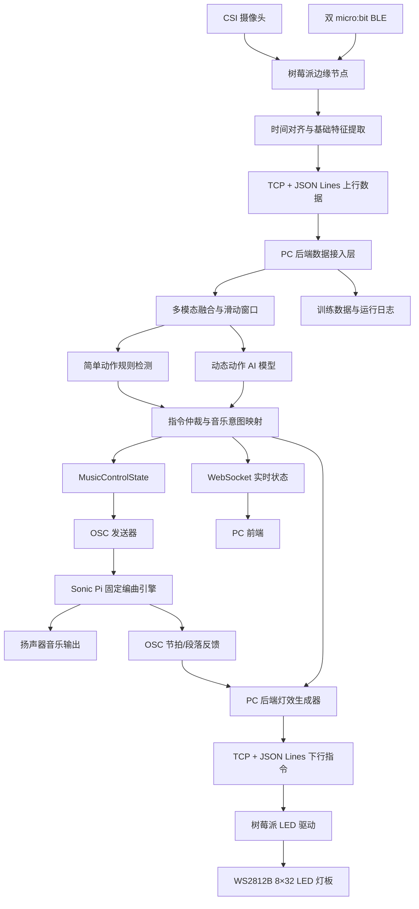

# AIoT 智能指挥演奏系统设计方案

## 1.项目名称


------

## 2.项目定位

本项目面向 AIoT 课程设计，构建一个能够通过用户双手动作和 micro:bit 传感信息实时控制音乐表现的智能指挥系统。

系统采用 **“树莓派边缘感知节点 + PC 本地智能控制中心 + Sonic Pi 音乐执行引擎 + LED 节奏反馈节点”** 的分布式 AIoT 架构：

- 树莓派负责摄像头采集、micro:bit 信息接收、时间戳同步和基础特征提取和 LED 驱动；
- PC 负责后端服务、AI 模型训练与推理、控制决策、前端展示和数据存储；
- Sonic Pi 负责运行预先确定的编曲，并根据 PC 后端命令实时改变 BPM、鼓点、音量、音乐能量、乐器层和段落；
- LED 灯板根据真实音乐节拍、音乐能量及用户动作反馈显示灯效。

------

## 3.项目目标

1. 实现摄像头对用户双手动作的实时采集；
2. 实现 micro:bit 对双腕加速度、姿态、按键和摇晃事件的采集；
3. 实现树莓派与 PC 之间的低延迟双向通信；
4. 在 PC 端完成动作识别模型训练与本地部署；
5. 将动作识别结果映射为统一的音乐控制状态；
6. 通过 OSC 协议控制 Sonic Pi 的固定编曲和实时音乐参数；
7. 通过前端页面展示设备状态、动作识别结果、音乐参数和 LED 状态；
8. 通过 WS2812B LED 灯板显示节拍、强拍、音乐能量、动作确认和异常状态；
9. 体现“传感器采集—边缘预处理—网络通信—本地 AI—音乐执行—物理反馈”的完整 AIoT 链路。

------

## 4.整体架构

### 4.1 系统节点划分

| 节点      | 定位               | 主要作用                                                     |
| --------- | ------------------ | ------------------------------------------------------------ |
| 摄像头    | 视觉感知设备       | 捕捉双手关键点、空间位置、速度、轨迹和手掌状态               |
| micro:bit | IoT 传感节点       | 采集双腕三轴加速度、姿态、按键及摇晃事件                     |
| 树莓派    | 边缘感知与执行节点 | 接入摄像头和 micro:bit，完成时间同步、预处理、即时特征提取和 LED 驱动 |
| PC 后端   | 本地智能控制中心   | 完成数据接入、AI 推理、动作仲裁、音乐控制、灯效指令生成和数据记录 |
| Sonic Pi  | 音乐执行引擎       | 运行预先编排的音乐，接收 OSC 命令并在节拍边界修改音乐状态    |
| PC 前端   | 可视化与人工控制端 | 显示动作、BPM、音乐状态、传感器状态，提供测试和人工覆盖控制  |
| LED 灯板  | 物理交互反馈节点   | 显示节拍、强拍、能量、段落、动作确认、校准和故障状态         |

------

### 4.2 总体架构流程



### 4.3 控制闭环

```text
用户动作
  ↓
视觉与惯性传感器采集
  ↓
树莓派同步、预处理并传输
  ↓
PC 后端识别动作和指挥意图
  ↓
Sonic Pi 改变音乐表现
  ↓
Sonic Pi 返回真实节拍事件
  ↓
PC 生成与音乐同步的 LED 灯效
  ↓
用户看到并听到反馈，继续调整动作
```

## 5.节点间通信方式

### 5.1 摄像头 --> 树莓派

#### 5.1.1 主要内容

| 内容       | 说明                                                   |
| ---------- | ------------------------------------------------------ |
| 连接方式   | 树莓派 CSI 摄像头                                      |
| 采集方式   | Picamera2                                              |
| 树莓派程序 | Python + MediaPipe Hand Landmarker + OpenCV            |
| 采集内容   | 视频帧、左右手、21 个关键点、置信度、相对三维坐标      |
| 输出数据   | 手部即时特征和简化关键点数据，不持续向 PC 发送原始视频 |

#### 5.1.2 程序作用

**MediaPipe Hand Landmarker**：将原始图像转换成：

```
左右手
21 个关键点
置信度
三维相对坐标
```

**OpenCV**： 图像格式转换、缩放、翻转和结果绘制

**Picamera2**： 采集 CSI 摄像头帧和 SensorTimestamp

```
Picamera2
    │ 获取 RGB888 图像和 SensorTimestamp
    ▼
OpenCV
    ├── resize
    ├── flip
    ├── 色彩转换
    └── 调试绘制
    ▼
MediaPipe Hand Landmarker
    ├── handedness
    ├── 21 landmarks
    └── confidence
    ▼
自定义即时特征模块
    ├── 手掌中心与手腕位置
    ├── 手掌开合度
    ├── 双手距离
    ├── 手腕速度
    ├── 运动方向
    └── 固定手势候选特征
```

#### 5.1.3 视频参数（参考）

| 参数     | 推荐值                    |
| -------- | ------------------------- |
| 分辨率   | 640×480                   |
| 帧率     | 30 FPS                    |
| 格式     | RGB888                    |
| 最大手数 | 2                         |
| 模型     | MediaPipe Hand Landmarker |
| 缓冲     | 3～4 帧                   |

------

### 5.2 micro:bit 与树莓派通信

| 内容           | 说明                                                   |
| -------------- | ------------------------------------------------------ |
| 连接方式       | BLE                                                    |
| micro:bit 程序 | MakeCode                                               |
| 树莓派接收库   | Python `Bleak`                                         |
| 采集内容       | `acc_x`、`acc_y`、`acc_z`、Pitch、Roll、按键和摇晃事件 |
| 输出格式       | 20 字节紧凑二进制数据包                                |
| 采样率         | 25～50 Hz                                              |

#### 5.2.1 数据包设计

```text
uint8   version
uint8   hand
uint16  sequence
uint32  device_timestamp_ms
int16   ax_mg
int16   ay_mg
int16   az_mg
int16   pitch_deg
int16   roll_deg
uint8   flags
uint8   checksum
```

字段定义：

| 字段                  | 大小 | 含义                         |
| --------------------- | ---: | ---------------------------- |
| `version`             |  1 B | 协议版本                     |
| `hand`                |  1 B | 0=left，1=right              |
| `sequence`            |  2 B | 包序号，用于检测丢包         |
| `device_timestamp_ms` |  4 B | micro:bit 启动后的毫秒时间   |
| `ax_mg`               |  2 B | X 轴加速度，单位 mg          |
| `ay_mg`               |  2 B | Y 轴加速度，单位 mg          |
| `az_mg`               |  2 B | Z 轴加速度，单位 mg          |
| `pitch_deg`           |  2 B | Pitch 角度                   |
| `roll_deg`            |  2 B | Roll 角度                    |
| `flags`               |  1 B | A/B 按键、摇晃、校准等状态位 |
| `checksum`            |  1 B | 简单校验或 CRC-8             |

#### 5.2.2 BLE 通信架构

```
micro:bit（BLE Peripheral）
    └── 自定义 UART Service / Notify Characteristic
             ↓ Notify
树莓派（BLE Central）
    ├── BlueZ
    ├── Python Bleak
    ├── 同时连接左右手设备
    └── 记录接收时刻与设备时间戳
```

------

### 5.3 树莓派 ↔ PC 后端

#### 5.3.1 主要内容

| 内容     | 说明                                             |
| -------- | ------------------------------------------------ |
| 通信方案 | WebSocket/MQTT/TCP + JSON Lines(倾向)            |
| 数据类型 | JSON                                             |
| 数据格式 | fused_frame/window_features/control_event/status |
| 通信端口 | 9000                                             |

#### 5.3.2 通信方案解释

| 指标       | TCP + JSON Lines | WebSocket       | MQTT                       |
| ---------- | ---------------- | --------------- | -------------------------- |
| 基础延迟   | 最低             | 很低            | 较低                       |
| 协议开销   | 最小             | 较小            | 较大                       |
| 消息边界   | 需要自行处理     | 原生支持        | 原生支持                   |
| 浏览器支持 | 不支持           | 原生支持        | 通常需 MQTT over WebSocket |
| 双向通信   | 支持             | 支持            | 支持发布/订阅              |
| 多消费者   | 需自行实现       | Server 自行广播 | 原生支持                   |
| Broker     | 不需要           | 不需要          | 需要                       |
| 重连       | 自行实现         | 库通常支持      | 客户端通常支持             |
| QoS        | 依赖 TCP         | 依赖 TCP        | 可配置                     |
| 日志保存   | 非常方便         | 需转换          | 需订阅保存                 |
| 开发复杂度 | 最低             | 中等            | 最高                       |

#### 5.3.3 上行数据类型

| 数据类型          | 内容                                             | 树莓派负责生成什么           | PC 收到后做什么            | 是否直接控制音乐 |
| ----------------- | ------------------------------------------------ | ---------------------------- | -------------------------- | ---------------- |
| `fused_frame`     | 一个统一时间点上的完整感知状态                   | 单时刻同步数据和即时特征     | 实时显示、调试、模型输入   | 否               |
| `window_features` | 最近一段时间内多个`fused_frame` 的统计和时序描述 | 最近时间窗口的动态特征       | 动态动作模型和音乐意图估计 | 通常否           |
| `control_event`   | 检测候选事件和安全事件                           | 简单动作、候选事件和安全事件 | 执行、复核或作为模型证据   | 可以             |
| `status`          | 系统健康状态，不表示用户动作                     | 设备和链路健康状态           | 状态显示、降级和重连       | 否               |

(micro:bit 按键承担安全和系统级控制，向 PC 传输高优先级 control_event)

示例：

| 按键操作    | 功能           |
| ----------- | -------------- |
| 左手 A      | 开始或继续     |
| 左手 B      | 暂停           |
| 右手 A      | 风格切换       |
| 右手 B 长按 | 紧急停止       |
| A+B         | 重新校准或复位 |

#### 5.3.4 下行数据类型(参考)

后两个类型是否保留？

| 类型             | PC 发送内容                            | 树莓派用途                       |
| ---------------- | -------------------------------------- | -------------------------------- |
| `led_command`    | 一次性灯效事件                         | 播放动作确认、强拍闪烁、错误提示 |
| `led_state`      | 持续灯效状态                           | 更新 BPM、能量、亮度和段落颜色   |
| `led_config`     | 最大亮度、矩阵排列、GPIO、限流参数     | 初始化或修改 LED 驱动配置        |
| `system_command` | 校准、重启采集、清空缓存、进入降级模式 | 控制边缘节点                     |
| `time_sync`      | PC 当前单调时钟和同步序号              | 估计 Pi 与 PC 的时间偏移         |

#### 5.3.5 时间同步方案

不同设备不能直接比较各自的启动时间，因此统一使用以下方式：

1. micro:bit 数据保留 `device_timestamp_ms`；
2. 树莓派收到 BLE 包时记录 `pi_monotonic_ns`；
3. 摄像头使用 `SensorTimestamp`，转换到树莓派单调时钟基准；
4. 树莓派周期性与 PC 进行 ping/pong，估计网络往返时间和时钟偏移；
5. PC 将所有数据转换为 `pc_monotonic_ns` 后进入统一滑动窗口；
6. 音乐命令增加 `command_id`、`created_at_ns` 和 `apply_at`，防止旧命令覆盖新命令。

推荐同步容差：

| 数据               |             对齐容差 |
| ------------------ | -------------------: |
| 摄像头与 micro:bit |           ±20～40 ms |
| 简单动作事件       |               ±80 ms |
| 动态动作窗口       |           0.5～1.5 s |
| LED 强拍同步       | 尽量控制在 ±30 ms 内 |

------

### 5.4 PC 后端 ↔ 前端(参考)

| 内容        | 说明                                                         |
| ----------- | ------------------------------------------------------------ |
| 通信方式    | WebSocket + REST API                                         |
| 后端框架    | FastAPI                                                      |
| 前端技术    | HTML/CSS/JavaScript，后期可扩展 Vue/React                    |
| 实时展示    | 当前动作、置信度、BPM、节拍、音乐能量、设备状态和 LED 状态   |
| 人工控制(?) | 开始、暂停、停止、参数测试、风格切换、校准、数据录制和模型切换 |

### 5.5 PC 后端提供的接口(参考 未审查)

#### 5.5.1 WebSocket 接口

| 接口                     | 方向          | 作用                                                       |
| ------------------------ | ------------- | ---------------------------------------------------------- |
| `WebSocket /ws/pi`       | 树莓派 ↔ PC   | 接收实时感知数据；若实际实现采用原生 TCP，则该接口可不启用 |
| `TCP :9000`              | 树莓派 ↔ PC   | 本方案主要的 Pi 数据接入与 LED 指令下发通道                |
| `WebSocket /ws/frontend` | PC → 浏览器   | 推送识别结果、音乐状态、节拍、设备状态和灯效状态           |
| `WebSocket /ws/debug`    | PC → 调试工具 | 推送降采样后的原始特征、模型输出和延迟统计                 |

`/ws/frontend` 推荐推送消息：

```json
{
  "type": "runtime_state",
  "timestamp_ms": 125403,
  "gesture": {
    "name": "conducting_downbeat",
    "confidence": 0.91,
    "source": "multimodal_model"
  },
  "music": {
    "playing": true,
    "bpm": 112.5,
    "beat": 3,
    "bar": 18,
    "section": "chorus",
    "energy": 0.78,
    "drum_amp": 0.84
  },
  "devices": {
    "camera": "online",
    "microbit_left": "online",
    "microbit_right": "online",
    "sonic_pi": "online",
    "led": "online"
  }
}
```

#### 5.5.2 系统与状态接口

| 方法与路径                   | 作用                   | 主要返回/效果                   |
| ---------------------------- | ---------------------- | ------------------------------- |
| `GET /api/status`            | 获取系统总体状态       | 节点在线状态、延迟、FPS、丢包率 |
| `GET /api/health`            | 健康检查               | 后端是否可用                    |
| `GET /api/config`            | 获取当前配置           | 模型、动作映射、音乐和 LED 配置 |
| `PUT /api/config`            | 修改允许在线调整的配置 | 更新阈值、平滑系数和亮度上限    |
| `POST /api/system/calibrate` | 开始姿态与空间范围校准 | 通知树莓派并进入校准状态        |
| `POST /api/system/reset`     | 清空运行状态           | 重置窗口、动作锁和音乐目标参数  |

#### 5.5.3 音乐控制接口

| 方法与路径                          | 作用                 | 说明                               |
| ----------------------------------- | -------------------- | ---------------------------------- |
| `POST /api/music/start`             | 开始或继续演奏       | 将 `playing` 设为 true             |
| `POST /api/music/pause`             | 暂停产生新音符       | 保留当前段落和参数                 |
| `POST /api/music/stop`              | 停止并复位           | 最高优先级普通控制                 |
| `POST /api/music/emergency-stop`    | 紧急停止             | 清空队列、关闭音乐和高亮红色故障灯 |
| `POST /api/music/state`             | 一次更新多个连续参数 | BPM、音量、能量、乐器层等          |
| `PATCH /api/music/parameter/{name}` | 测试单个参数         | 前端调试滑块使用                   |
| `POST /api/music/accent`            | 触发一次重音         | 量化到当前或下一个节拍             |
| `POST /api/music/section`           | 请求段落切换         | 通常在下一小节生效                 |
| `POST /api/music/style`             | 切换风格预设         | 在允许的段落边界切换               |
| `GET /api/music/state`              | 获取实际音乐状态     | 返回 Sonic Pi 最近反馈的状态       |
| `GET /api/music/mappings`           | 获取动作—音乐映射    | 供前端展示                         |
| `PUT /api/music/mappings`           | 修改映射配置         | 保存映射版本，避免直接修改代码     |

`POST /api/music/state` 示例：

```json
{
  "source": "frontend_debug",
  "bpm": 112,
  "master_amp": 0.85,
  "drum_amp": 0.9,
  "drum_density": 0.65,
  "bass_amp": 0.55,
  "harmony_amp": 0.7,
  "melody_amp": 0.8,
  "energy": 0.76,
  "reverb_mix": 0.2,
  "cutoff": 95
}
```

#### 5.5.4 动作识别和训练接口

| 方法与路径                  | 作用                             |
| --------------------------- | -------------------------------- |
| `POST /api/recording/start` | 开始采集指定动作的训练样本       |
| `POST /api/recording/stop`  | 结束采集并写入文件               |
| `POST /api/recording/mark`  | 在连续录制中标记动作起止点       |
| `GET /api/models`           | 查询可用模型和版本               |
| `POST /api/models/load`     | 加载指定本地模型                 |
| `POST /api/models/reload`   | 重新载入当前模型                 |
| `GET /api/gestures`         | 获取动作定义、阈值和当前启用状态 |
| `PUT /api/gestures/{name}`  | 修改动作阈值、冷却时间或是否启用 |

#### 5.5.5 LED 控制接口

| 方法与路径                 | 作用                             |
| -------------------------- | -------------------------------- |
| `POST /api/led/test`       | 播放指定测试灯效                 |
| `POST /api/led/brightness` | 调整全局亮度上限                 |
| `POST /api/led/mode`       | 切换节拍、能量、调试或关闭模式   |
| `GET /api/led/state`       | 查询当前灯效状态和树莓派确认信息 |

---

### 5.6 PC 后端 ↔ Sonic Pi(参考)

#### 5.6.1 通信方案

采用 **OSC over UDP**：

| 方向               | 地址与端口       | 作用                               |
| ------------------ | ---------------- | ---------------------------------- |
| PC 后端 → Sonic Pi | `127.0.0.1:4560` | 发送播放、参数、段落和重音命令     |
| Sonic Pi → PC 后端 | `127.0.0.1:4561` | 返回真实节拍、段落、状态和命令确认 |

PC 后端与 Sonic Pi 运行在同一台 PC 上，因此默认只监听本机地址，避免开放远程 OSC 带来的误控制风险。

Sonic Pi 默认可在本机 4560 端口接收 OSC。外部消息进入 Sonic Pi 后会加入其 Time State，程序可通过 `sync "/osc*/..."` 获取。Sonic Pi 也可以按音乐时间主动向后端发送 OSC，因此可把真实节拍反馈给 LED 控制模块。

#### 5.6.2 PC 后端内部音乐控制状态

后端不应把每个模型输出直接发送给 Sonic Pi，而应先生成统一状态：

```python
MusicControlState = {
    "playing": True,
    "bpm": 112.0,
    "master_amp": 0.85,
    "drum_amp": 0.90,
    "drum_density": 0.65,
    "bass_amp": 0.55,
    "harmony_amp": 0.70,
    "melody_amp": 0.80,
    "energy": 0.76,
    "reverb_mix": 0.20,
    "cutoff": 95,
    "section": "chorus",
    "style": "electronic"
}
```

该对象由以下步骤产生：

```text
模型原始输出
  ↓
置信度过滤
  ↓
动作优先级仲裁
  ↓
动作到音乐参数映射
  ↓
限幅与安全检查
  ↓
EMA / 滞回平滑
  ↓
节拍量化与命令去重
  ↓
OSC 发送
```

#### 5.6.3 OSC 路径设计

##### PC 后端 → Sonic Pi

| OSC 路径               | 参数                                                         | 用途                                    | 生效时机                               |
| ---------------------- | ------------------------------------------------------------ | --------------------------------------- | -------------------------------------- |
| `/conductor/transport` | `command_id, action`                                         | `start`、`pause`、`stop`、`reset`       | 立即或下一拍                           |
| `/conductor/state`     | `command_id, bpm, master_amp, drum_amp, drum_density, bass_amp, harmony_amp, melody_amp, energy, reverb_mix, cutoff` | 批量更新连续参数                        | 连续参数下一拍；BPM 可下一拍或下一小节 |
| `/conductor/bpm`       | `command_id, bpm`                                            | 单独更新目标 BPM                        | 推荐下一拍平滑生效                     |
| `/conductor/accent`    | `command_id, strength, type`                                 | 触发重音、镲片或低音鼓                  | 当前最近节拍或下一拍                   |
| `/conductor/section`   | `command_id, section`                                        | 切换 Intro、Verse、Build、Chorus、Outro | 下一小节                               |
| `/conductor/style`     | `command_id, style`                                          | 切换节奏和音色预设                      | 下一小节或段落边界                     |
| `/conductor/layer`     | `command_id, layer, enabled, amp`                            | 启停指定乐器层                          | 下一拍或下一小节                       |
| `/conductor/effect`    | `command_id, effect, value`                                  | 调整滤波、混响等效果                    | 平滑连续生效                           |
| `/conductor/ping`      | `sequence, sent_ns`                                          | 检测 Sonic Pi 是否在线                  | 立即                                   |

##### Sonic Pi → PC 后端

| OSC 路径       | 参数                            | 用途                          |
| -------------- | ------------------------------- | ----------------------------- |
| `/music/beat`  | `bar, beat, bpm, beat_strength` | 生成与真实音乐同步的 LED 节拍 |
| `/music/bar`   | `bar, section`                  | 段落和小节灯效切换            |
| `/music/state` | `playing, bpm, section, energy` | 前端显示实际执行状态          |
| `/music/ack`   | `command_id, result`            | 确认某条命令已接受或应用      |
| `/music/pong`  | `sequence, received_time`       | 在线检测                      |
| `/music/error` | `code, message`                 | 通知参数或运行错误            |

#### 5.6.4 PC 后端发送示例

```python
from pythonosc.udp_client import SimpleUDPClient

sonic_pi = SimpleUDPClient("127.0.0.1", 4560)

sonic_pi.send_message(
    "/conductor/state",
    [
        1201,       # command_id
        112.0,      # bpm
        0.85,       # master_amp
        0.90,       # drum_amp
        0.65,       # drum_density
        0.55,       # bass_amp
        0.70,       # harmony_amp
        0.80,       # melody_amp
        0.76,       # energy
        0.20,       # reverb_mix
        95.0        # cutoff
    ]
)
```

#### 5.6.5 Sonic Pi 内部数据处理

Sonic Pi 内部划分为五层：

```text
1. OSC 接收层
   ├── 接收 transport/state/accent/section/style
   └── use_real_time，尽快读取外部事件

2. 目标状态层
   ├── set :target_bpm
   ├── set :target_energy
   ├── set :target_drum_amp
   └── 保存最新 command_id

3. 平滑与量化层
   ├── 连续参数逐拍逼近目标值
   ├── BPM 限制单次变化幅度
   ├── 段落切换等待下一小节
   └── 重音事件对齐到最近节拍

4. 编曲执行层
   ├── 全局 conductor/bar_clock
   ├── drums live_loop
   ├── bass live_loop
   ├── harmony live_loop
   ├── melody live_loop
   └── FX / accent live_loop

5. 状态反馈层
   ├── 每拍发送 /music/beat
   ├── 每小节发送 /music/bar
   ├── 参数应用后发送 /music/ack
   └── 周期发送 /music/state
```

Sonic Pi 核心代码结构示例：

```ruby
use_osc "127.0.0.1", 4561

set :playing, false
set :current_bpm, 100.0
set :target_bpm, 100.0
set :current_energy, 0.5
set :target_energy, 0.5
set :current_drum_amp, 0.7
set :target_drum_amp, 0.7
set :pending_section, :intro
set :current_section, :intro

live_loop :osc_state_receiver do
  use_real_time
  command_id, bpm, master_amp, drum_amp, drum_density,
    bass_amp, harmony_amp, melody_amp, energy,
    reverb_mix, cutoff = sync "/osc*/conductor/state"

  set :target_bpm, bpm
  set :target_drum_amp, drum_amp
  set :target_energy, energy
  set :last_command_id, command_id
end

live_loop :parameter_smoother do
  use_bpm get(:current_bpm)

  bpm = get(:current_bpm)
  target_bpm = get(:target_bpm)
  next_bpm = bpm + [[target_bpm - bpm, 2.0].min, -2.0].max
  set :current_bpm, next_bpm

  energy = get(:current_energy)
  target_energy = get(:target_energy)
  set :current_energy, energy + (target_energy - energy) * 0.25

  sleep 1
end

live_loop :bar_clock do
  use_bpm get(:current_bpm)

  4.times do |beat_index|
    osc "/music/beat", tick(:global_beat) / 4, beat_index + 1,
        get(:current_bpm), beat_index == 0 ? 1.0 : 0.5
    sleep 1
  end

  set :current_section, get(:pending_section)
  osc "/music/bar", look(:global_beat) / 4, get(:current_section).to_s
end
```

实际代码中需为每个乐器层建立独立 `live_loop`，并通过共享 Time State 读取当前参数。多个循环以同一个 `bar_clock` 或节拍事件对齐。

#### 5.6.6 预先确定编曲的组织方式

推荐将固定编曲分为：

```text
Intro   8 小节
Verse  16 小节
Build   8 小节
Chorus 16 小节
Outro   8 小节
```

每个段落预先定义：

- 和弦进行；
- 主旋律和贝斯音符；
- 基础鼓点 pattern；
- 可启用的乐器层；
- 默认能量、音量和效果器范围；
- 可以由手势修改的参数上限与下限。

如果使用预制音频分轨，应切成 1～4 小节的短 Stem，而不是直接播放整首混合 MP3。已经触发的长音频不会因为后续 BPM 命令自动重新拉伸，短循环才能在边界按新 BPM 重新触发。

------

### 5.7 PC 后端 → 树莓派 LED

| 内容       | 说明                                                       |
| ---------- | ---------------------------------------------------------- |
| 通信方案   | TCP + JSON Lines，与感知数据复用同一长期连接               |
| 通信内容   | `led_command`、`led_state`、`led_config`、`system_command` |
| 树莓派实现 | `asyncio` + LED 命令队列                                   |
| LED 驱动   | rpi-ws281x                                                 |

```
Sonic Pi 真实节拍反馈 + PC 动作结果
                  ↓
           PC 灯效生成器
                  ↓
         led_state / led_command
                  ↓
          树莓派 LED 队列
                  ↓
        WS2812B 8×32 灯板
```

持续状态示例：

```json
{
  "type": "led_state",
  "sequence": 8031,
  "bpm": 112.0,
  "bar": 18,
  "beat": 3,
  "section": "chorus",
  "energy": 0.78,
  "brightness": 0.55,
  "mode": "performance"
}
```

一次性事件示例：

```json
{
  "type": "led_command",
  "event_id": 1802,
  "effect": "accent_flash",
  "strength": 0.92,
  "duration_ms": 120,
  "priority": 60
}
```

------

## 6.节点内处理内容

```
左手 micro:bit ─┐
                 ├─ BLE ─────────────┐
右手 micro:bit ─┘                    │
                                      ▼
摄像头 ─ CSI ───────────────────── 树莓派
                                      │
                                      ├── 摄像头采集
                                      ├── MediaPipe 关键点提取
                                      ├── BLE 数据接收
                                      ├── 时间同步
                                      ├── 基础校准与滤波
                                      ├── 数据打包
                                      └── LED 硬件执行
                                              │
                                              ▼
                                             PC
                                      ├── 视觉特征提取
                                      ├── IMU 特征提取
                                      ├── 固定手势识别
                                      ├── 动态动作识别
                                      ├── 时序模型
                                      ├── BPM 分析
                                      ├── 音乐控制
                                      ├── LED 灯效决策
                                      └── 模型训练
```

#### 6.1 树莓派

```text
摄像头采集
BLE 数据接收
设备时间映射
帧级数据融合
即时特征提取
简单动作候选检测
数据上报与缓存
接收 PC 下行命令
LED 灯效调度与输出
设备状态监控
```

树莓派只做计算量较低、确定性较强的处理，不承担主动态动作模型推理。这样可以降低树莓派负载，并便于在 PC 上统一升级模型。

#### 6.2 PC 后端

PC 后端建议拆分为以下模块：

| 模块                   | 主要职责                                               |
| ---------------------- | ------------------------------------------------------ |
| `PiGateway`            | 接收 TCP JSON Lines、校验消息、维护连接和心跳          |
| `TimeAligner`          | 将树莓派时间映射到 PC 时间，处理乱序和迟到数据         |
| `FeatureWindow`        | 建立 0.5～1.5 秒滑动窗口，生成动态特征                 |
| `RuleGestureDetector`  | 识别静态手势、按键和安全事件                           |
| `MotionModelService`   | 运行时序 AI 模型，识别周期挥拍、上扬、下击、画圈等动作 |
| `IntentMapper`         | 将动作和连续特征转换为音乐意图                         |
| `CommandArbiter`       | 处理冲突、优先级、冷却时间、去重和状态机               |
| `MusicStateController` | 维护目标音乐状态，进行限幅、平滑和节拍量化             |
| `SonicPiOscAdapter`    | 向 Sonic Pi 发送 OSC 并接收反馈                        |
| `LedEffectEngine`      | 根据实际节拍和动作结果生成 LED 指令                    |
| `FrontendHub`          | 通过 WebSocket 推送实时状态                            |
| `Recorder`             | 保存训练数据、模型输出、最终命令和延迟统计             |

------

## 7.手势动作对音乐和 LED 的作用效果


## 8.最终技术选型汇总

| 功能           | 技术                                                       |
| -------------- | ---------------------------------------------------------- |
| CSI 摄像头采集 | Picamera2                                                  |
| 图像预处理     | OpenCV                                                     |
| 手部关键点     | MediaPipe Hand Landmarker                                  |
| micro:bit 通信 | BLE + MakeCode + Bleak                                     |
| Pi 数据处理    | Python + asyncio                                           |
| Pi ↔ PC        | TCP + JSON Lines                                           |
| PC 后端        | FastAPI + asyncio                                          |
| AI 推理        | scikit-learn / PyTorch / TensorFlow Lite，按模型复杂度选择 |
| PC ↔ Sonic Pi  | OSC over UDP + python-osc                                  |
| 音乐编曲与执行 | Sonic Pi `live_loop` + Time State + Sample/Synth           |
| PC ↔ 前端      | REST API + WebSocket                                       |
| LED 驱动       | rpi-ws281x                                                 |
| 数据记录       | JSONL / CSV / SQLite                                       |

## 9.建议开发顺序

### 阶段一：打通最小闭环

```text
前端按钮
  → FastAPI
  → OSC
  → Sonic Pi 开始/暂停/BPM/重音
  → Sonic Pi 返回 beat
  → PC 发送 LED 指令
  → 树莓派点亮灯板
```

先不接摄像头和模型，验证音乐与 LED 链路。

### 阶段二：接入简单动作

完成：

- micro:bit 按键控制；
- 双手张开开始；
- 双拳暂停；
- 下击重音；
- 前端显示最终执行结果。

### 阶段三：动态动作与 AI

完成：

- 挥拍 BPM 估计；
- 动作幅度到 Energy 的回归；
- 双手距离控制乐器层；
- 左手高度控制旋律或和声；
- 本地训练数据采集和模型部署。

### 阶段四：稳定性与展示

完成：

- 指令仲裁和人工锁定；
- 设备断线降级；
- 延迟统计；
- 固定完整编曲；
- 前端可视化优化；
- 演示脚本和异常恢复流程。


